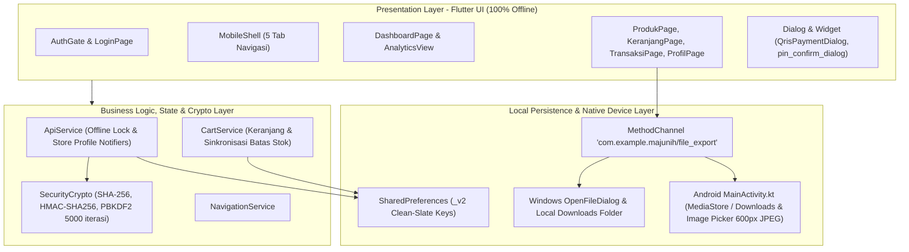
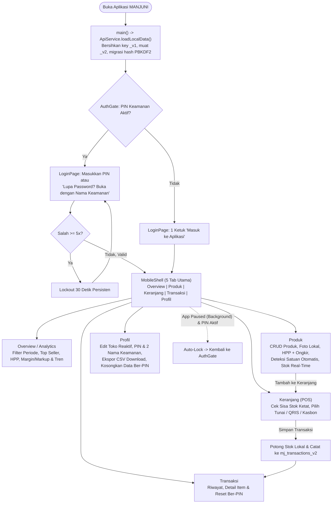

# MANJUNI – Manajemen UMKM Terkini

**MANJUNI** adalah aplikasi kasir (*Point of Sale*), pengelolaan inventori produk, kalkulasi HPP &amp; laba rugi, serta pencatatan transaksi UMKM berbasis **Flutter** yang beroperasi **100% secara offline langsung di perangkat pengguna**.

---

## 1. Pengenalan Projek

### Gambaran Solusi

**MANJUNI (Manajemen UMKM Terkini)** menghadirkan solusi operasional toko dan pencatatan keuangan UMKM dalam satu aplikasi mobile yang ringkas, cepat, **bebas iklan, tanpa paywall/langganan**, dan **100% offline**. Seluruh proses—mulai dari pencatatan produk &amp; HPP, pemantauan stok real-time, transaksi kasir (`Tunai`, `QRIS`, `Kasbon`), dasbor analitik laba rugi, pengamanan PIN lokal berbasis PBKDF2, hingga cadangan laporan CSV ke folder `Download`—dieksekusi sepenuhnya di perangkat tanpa memerlukan koneksi internet maupun server eksternal.

### Latar Belakang

Pengembangan MANJUNI berangkat dari permasalahan nyata yang dialami pelaku UMKM sehari-hari:

1. **Hambatan biaya &amp; iklan pada aplikasi kasir yang ada**: Banyak aplikasi manajemen bisnis membatasi fitur penting di balik skema berbayar atau menampilkan iklan yang mengganggu kelancaran operasional toko.
2. **Kebutuhan pencatatan bisnis yang praktis**: Pelaku UMKM membutuhkan alat bantu yang sederhana namun mampu mencatat transaksi harian, menghitung Harga Pokok Penjualan (HPP) termasuk ongkos kirim, serta menampilkan perkiraan markup, margin, dan laba secara langsung.
3. **Risiko selisih stok akibat pencatatan manual**: Pencatatan stok secara manual lambat dan rentan membuat catatan berbeda dengan stok fisik. MANJUNI menyinkronkan sisa stok secara real-time saat barang masuk keranjang hingga checkout serta memberi indikator peringatan dini saat stok menipis (`< 50%` stok awal).
4. **Keterbatasan konektivitas di lapangan**: Tidak semua lokasi usaha UMKM memiliki akses internet yang stabil. Oleh karena itu, versi rilis final MANJUNI dikunci pada **mode 100% offline** agar usaha tetap berjalan lancar tanpa ketergantungan jaringan maupun biaya server.

### Target Pengguna

- **Pengguna Utama (*Primary User*)**: Pemilik UMKM dan pelaku usaha mandiri (warung kelontong, toko sembako, usaha makanan &amp; minuman, penjualan *snack*, bumbu dapur, kebutuhan rumah tangga, hingga pelaku ekonomi kreatif lokal).
- **Pengguna Pendukung (*Secondary User*)**: Kasir atau staf operasional toko yang mencatat transaksi harian, memantau sisa stok produk, dan melakukan pencadangan data penjualan ke CSV.

---

## 2. Identitas Kompetisi, Karya &amp; Tim


| Atribut                       | Keterangan                                                         |
| :----------------------------- | :------------------------------------------------------------------ |
| **Kategori Kompetisi**        | Local MSME &amp; Creative Economy                                  |
| **Judul Karya**               | MANJUNI – Manajemen UMKM Terkini                                   |
| **Institusi / Universitas**   | Universitas Indraprasta PGRI | Universitas Bina Sarana Informatika |
| **Fakultas / Departemen**     | Teknik Informatika | Teknik Informasi                              |
| **Nama Tim**                  | Bebas Kata Ferdi                                                   |
| **Ketua Tim / Penulis Utama** | Ahmad Raisul Siddiq                                                |


### Anggota Tim &amp; Jobdesk


| No. &amp; Peran                                                     | Nama Lengkap            |     |     |
| :------------------------------------------------------------------- | :----------------------- | :--- | --- |
| Anggota 1 – Project Manager, Backend Dev, QA Engineer, Frontend Dev | **Ahmad Raisul Siddiq** |     |     |
| Anggota 2 – UI/UX, QA Engineer                                      | **Azka Ezzikra**        |     |     |
| Anggota 3 – Frontend Dev, UI/UX, QA Engineer                        | **Muhamad Ferdi**       |     |     |
| Anggota 4 – Frontend Dev, Backend Dev, QA Engineer                  | **Ahmad Zani Syechkar** |     |     |


#### incian Pembagian Jobdesk

- **Ahmad Raisul Siddiq** (*Project Manager, Backend Dev, QA Engineer, Frontend Dev*): Mengoordinasikan perencanaan fitur, prioritas pengembangan, dan rilis versi stabil; merancang serta mengembangkan logika layanan lokal/offline (`ApiService`, `SecurityCrypto`), penyimpanan persisten (`SharedPreferences`), serta berkontribusi pada antarmuka Frontend dan pengujian QA.
- **Azka Ezzikra** (*UI/UX, QA Engineer*): Merancang tata letak antarmuka dan pengalaman pengguna agar intuitif bagi pelaku UMKM, serta melakukan pengujian QA fungsional dan verifikasi konsistensi alur antarhalaman.
- **Muhamad Ferdi** (*Frontend Dev, UI/UX, QA Engineer*): Mengimplementasikan tampilan dan komponen interaktif Flutter (navigasi 5 tab, form produk, keranjang, transaksi, dashboard/analytics), menyempurnakan aspek visual UI/UX, serta menjalankan pengujian QA.
- **Ahmad Zani Syechkar** (*Frontend Dev, Backend Dev, QA Engineer*): Mengembangkan fitur Frontend Flutter, layanan logika/penyimpanan data aplikasi beserta integrasi native perangkat (`MethodChannel` Android/file export), serta melakukan pengujian QA (unit, widget, dan keamanan).

---

## 3. Technical Documentation (Arsitektur Sistem &amp; Diagram Alur Program)

### Arsitektur Sistem (100% Offline / Local-First)

Aplikasi MANJUNI yang aktif berjalan di [`frontend/`](./frontend) dikunci penuh ke **mode 100% offline** tanpa koneksi ke server online:

- **Zero Network Dependency**: `ApiService.offlineModeNotifier` dikunci ke `true` (`isConnectedNotifier` ke `false`), dan [`AndroidManifest.xml`](./frontend/android/app/src/main/AndroidManifest.xml) **tidak mendeklarasikan izin `android.permission.INTERNET`**, serta menetapkan `android:allowBackup="false"` dan `android:usesCleartextTraffic="false"`.
- **Penyimpanan Lokal Terenkripsi/Tersusun (`_v2`)**: Seluruh data disimpan secara lokal melalui `SharedPreferences` dengan key clean-slate `_v2` (otomatis membersihkan key legacy `_v1` saat `loadLocalData()`), sedangkan kredensial PIN dan 2 Nama Keamanan di-hash menggunakan `PBKDF2-HMAC-SHA256` pada `SecurityCrypto`.
- **Native Device Bridge (`MethodChannel`)**: Pertukaran file dengan penyimpanan perangkat (memilih foto produk dan menyimpan CSV ke folder `Download`) ditangani langsung secara lokal melalui `MethodChannel('com.example.majunih/file_export')` pada [`MainActivity.kt`](./frontend/android/app/src/main/kotlin/com/example/majunih/MainActivity.kt) untuk Android serta `OpenFileDialog` native untuk Windows.



### Diagram Alur Program



---

## 4. Frontend Documentation (Framework, Struktur Komponen UI &amp; Aset)

### Framework &amp; Dependensi Utama

Dikonfigurasi pada [`frontend/pubspec.yaml`](./frontend/pubspec.yaml) (`name: majunih`, `version: 1.0.0+1`):

- **Framework**: Flutter &amp; Dart SDK `^3.13.7` (Material Design 3 dengan `ColorScheme.fromSeed(seedColor: Color(0xFF164E2E))`)
- **Dependensi Aktif**:
  - `shared_preferences: ^2.3.2` — penyimpanan persisten lokal 100% offline
  - `qr_flutter: ^4.1.0` — rendering kode QR lokal pada modal QRIS
  - `cupertino_icons: ^1.0.8` — koleksi ikon UI
  - `flutter_lints: ^6.0.0` — standar lint dan analisis statis ([`analysis_options.yaml`](./frontend/analysis_options.yaml))
  - *(Catatan: paket `http: ^1.6.0` masih tercantum di `pubspec.yaml` untuk kompatibilitas historis kelas layanan, namun aplikasi aktif berjalan 100% offline tanpa komunikasi server dan tanpa izin `INTERNET` pada Android manifest)*

### Struktur Komponen UI (`frontend/lib/`)

- **Entry Point &amp; Keamanan Siklus Hidup**:
  - [`main.dart`](./frontend/lib/main.dart) — memanggil `ApiService.loadLocalData()` lalu menjalankan `MyApp`.
  - [`app.dart`](./frontend/lib/app.dart) — konfigurasi tema, pembatasan `textScaler` (`0.85..1.15`), dan `AuthGate` dengan `WidgetsBindingObserver` untuk *auto-lock* otomatis saat aplikasi masuk ke latar belakang (`AppLifecycleState.paused`, dikecualikan saat `isPickingExternalFile` aktif).
- **Shell Navigasi**:
  - [`mobile_shell.dart`](./frontend/lib/mobile_shell.dart) — `IndexedStack` 5 tab (`Overview`, `Produk`, `Keranjang`, `Transaksi`, `Profil`) dilengkapi badge merah real-time dari `CartService.totalCount`.
  - [`shell.dart`](./frontend/lib/shell.dart) — shell alternatif berbasis drawer [`full_sidebar.dart`](./frontend/lib/widgets/full_sidebar.dart).
- **Halaman Utama (`frontend/lib/pages/`)**:
  - [`login_page.dart`](./frontend/lib/pages/login_page.dart) — gerbang masuk offline (1 ketuk bila tanpa PIN; verifikasi PIN &amp; pemulihan 2 Nama Keamanan bila PIN aktif).
  - [`dashboard_page.dart`](./frontend/lib/pages/dashboard_page.dart) — tab `Overview` dengan toggle *in-place* ke `AnalyticsView`, header toko klik-langsung ke Profil, filter `Today` / `This week` / `This month` / `All time`, **Top Seller**, dan **Recent activity**.
  - [`analytics_page.dart`](./frontend/lib/pages/analytics_page.dart) — `AnalyticsView` berisi 4 kartu metrik (`Penjualan`, `Pembelian`, `Laba Bersih`, `Transaksi`), custom canvas painter `_CompareBarPainter` (`Penjualan vs Pembelian`, `HPP`, `Laba Kotor`, `Margin Kotor (%)`, `Markup (vs HPP) (%)`), grafik tren produk terjual interaktif (`7 Hari`, `30 Hari`, `6 Bulan` dengan badge `Terbanyak`), dan `Komposisi Pembelian`.
  - [`produk_page.dart`](./frontend/lib/pages/produk_page.dart) — daftar &amp; form CRUD produk, kalkulasi real-time `Modal / Produk`, `Ongkir`, `HPP / Produk`, `Markup`, `Margin`, deteksi otomatis satuan (`pcs`, `kg`, `liter`, `ml`, `gram`, `bungkus`, `botol`, `kemasan`), filter 8 chip kategori, pencarian nama/kategori/barcode, upload foto lokal, peringatan stok menipis `< 50%`, validasi *auto-focus* (`FocusNode`), dan pengurangan sisa stok real-time (`Tambah` -&gt; `Habis`).
  - [`keranjang_page.dart`](./frontend/lib/pages/keranjang_page.dart) — daftar keranjang dengan thumbnail foto produk, kontrol kuantitas ketat sesuai stok, header nama toko reaktif, pemilihan `Tunai` / `QRIS` / `Kasbon`, serta penyimpanan checkout langsung tanpa baris diskon.
  - [`transaksi_page.dart`](./frontend/lib/pages/transaksi_page.dart) — `Omzet Hari Ini`, `Jumlah Transaksi`, pencarian riwayat (invoice/pelanggan/metode/produk), modal detail item (`cartItems`), serta tombol `Reset` berproteksi PIN.
  - [`profil_page.dart`](./frontend/lib/pages/profil_page.dart) — ubah nama &amp; kategori toko reaktif, statistik `Produk Terdaftar` &amp; `Total Transaksi`, manajemen PIN (Atur / Ganti / Nonaktifkan) &amp; Ganti 2 Nama Keamanan serentak (verifikasi PIN + 1 karakter terakhir kedua nama), **Cadangkan Data CSV** (`Semua` / `Perminggu` / `Bulan` / `Tahun`, `Salin CSV` &amp; `Simpan CSV`), serta `Kosongkan Data Aplikasi` berproteksi PIN.
  - `keranjang_ui.dart`, `produk_ui.dart`, `profil_ui.dart`, `transaksi_ui.dart` — wrapper kompatibilitas menuju masing-masing halaman.
- **Widget Reusable (`frontend/lib/widgets/`)**:
  - [`pin_confirm_dialog.dart`](./frontend/lib/widgets/pin_confirm_dialog.dart) — dialog `confirmSecurityPinForAction` untuk konfirmasi PIN pada aksi destruktif.
  - [`qris_payment_dialog.dart`](./frontend/lib/widgets/qris_payment_dialog.dart) — dialog pembayaran QRIS berbasis `qr_flutter` dengan info toko reaktif.
  - [`custom_app_bar.dart`](./frontend/lib/widgets/custom_app_bar.dart) dan [`full_sidebar.dart`](./frontend/lib/widgets/full_sidebar.dart).

### Aset Aplikasi (`frontend/assets/` &amp; Resource Android)

- **Aset Flutter (`pubspec.yaml`)**:
  - [`frontend/assets/images/app_logo.png`](./frontend/assets/images/app_logo.png) — logo utama MANJUNI yang ditampilkan pada antarmuka login dan identitas aplikasi.
- **Aset Android Native (`frontend/android/app/src/main/res/`)**:
  - Ikon peluncur adaptif &amp; multi-densitas (`mipmap-anydpi-v26/ic_launcher.xml`, `ic_launcher_round.xml`, serta `ic_launcher.png`, `ic_launcher_foreground.png`, `ic_launcher_round.png` pada folder `mipmap-mdpi` hingga `mipmap-xxxhdpi`).
  - Latar peluncuran &amp; tema (`drawable/launch_background.xml`, `drawable-v21/launch_background.xml`, `values/colors.xml`, `values/styles.xml`, `values-night/styles.xml`).

---

## 5. Penyimpanan Lokal (Aktif 100% Offline) &amp; Backend Documentation (Arsip/Referensi)

### A. Penyimpanan &amp; Skema Data Lokal Aplikasi Aktif (100% Offline)

> **Penting:** Aplikasi mobile MANJUNI yang berjalan saat ini beroperasi **100% secara offline** di perangkat pengguna, **tidak menggunakan file `.env`**, dan **tidak melakukan request ke server backend mana pun**.

Seluruh persistensi aplikasi menggunakan `SharedPreferences` dengan key `_v2`:


| Kategori Data                 | Key `SharedPreferences`                                                                                                                                                                                                                                                                             | Deskripsi Isi Data                                                                                                                                                                                           |
| :----------------------------- | :--------------------------------------------------------------------------------------------------------------------------------------------------------------------------------------------------------------------------------------------------------------------------------------------------- | :------------------------------------------------------------------------------------------------------------------------------------------------------------------------------------------------------------ |
| **Produk &amp; Kategori**     | `mj_products_v2`, `mj_deleted_products_v2`                                                                                                                                                                                                                                                          | Daftar produk (`id`, `name`, `price`, `cost_price`, `shipping_cost`, `hpp_per_unit`, `stock`, `initial_stock`, `unit`, `category`, `weight`, `barcode`, `image` base64 data URI) dan daftar produk terhapus. |
| **Transaksi &amp; Pelanggan** | `mj_transactions_v2`, `mj_customers_v2`, `mj_users_v2`                                                                                                                                                                                                                                              | Riwayat transaksi lokal (`id`, `transaction_date`, `payment_method`, `total_amount`, `cartItems`, `customer_name`) serta daftar pelanggan/pengguna lokal.                                                    |
| **Keranjang**                 | `mj_cart_v2`                                                                                                                                                                                                                                                                                        | Item aktif di keranjang (`productId`, `name`, `price`, `costPrice`, `unit`, `maxStock`, `image`, `category`, `qty`).                                                                                         |
| **Identitas Toko**            | `store_name`, `store_category`                                                                                                                                                                                                                                                                      | Nama toko &amp; kategori usaha yang disinkronkan secara reaktif melalui `storeNameNotifier` dan `storeCategoryNotifier`.                                                                                     |
| **Keamanan &amp; Rate-Limit** | `mj_security_pin_v2`, `mj_security_name_1_v2`, `mj_security_name_2_v2`, `mj_security_last_char_1_v2`, `mj_security_last_char_2_v2`, `mj_pin_failed_attempts_v2`, `mj_pin_lockout_until_v2`, `mj_recovery_failed_attempts_v2`, `mj_recovery_lockout_until_v2`, `mj_auth_token_v2`, `mj_auth_user_v2` | Hash PBKDF2-HMAC-SHA256 untuk PIN &amp; 2 Nama Keamanan, hash karakter terakhir untuk verifikasi ganti nama keamanan, serta penghitung gagal &amp; waktu berakhir lockout 30 detik.                          |


### B. Backend Documentation — Arsip Prototipe Laravel (`backend/`)

> **Catatan:** Direktori [`backend/`](./backend) berisi prototipe awal REST API berbasis **Laravel 11 (PHP `^8.2`) + Laravel Sanctum** dari tahap perancangan terdahulu. Modul ini **tidak digunakan dan tidak perlu dijalankan** agar aplikasi MANJUNI (Flutter 100% offline) berfungsi, namun terdokumentasi di bawah ini sebagai referensi arsitektur API, skema database relasional, dan konfigurasi `.env.example` yang tersedia di repositori.

#### 1. Ringkasan API Endpoints ([`backend/routes/api.php`](./backend/routes/api.php))

Seluruh route berada di bawah prefix `/api/v1` (mayoritas dilindungi middleware `auth:sanctum` dan pembagian peran `owner`, `cashier`, `partner`):


| Kelompok                                   | Method &amp; Endpoint                                                                                                                                                                                                                                                                                                                                                    | Deskripsi Singkat                                                                                                      |
| :------------------------------------------ | :------------------------------------------------------------------------------------------------------------------------------------------------------------------------------------------------------------------------------------------------------------------------------------------------------------------------------------------------------------------------ | :---------------------------------------------------------------------------------------------------------------------- |
| **Health &amp; Auth**                      | `GET /v1/health`, `POST /v1/auth/register`, `POST /v1/auth/login`, `POST /v1/auth/logout`, `GET /v1/auth/profile`, `POST /v1/auth/password`, `GET /v1/user`                                                                                                                                                                                                              | Cek status API, registrasi usaha, autentikasi Sanctum &amp; profil pengguna                                            |
| **Kategori &amp; Produk**                  | `GET/POST /v1/categories`, `PUT/PATCH/DELETE /v1/categories/{category}`, `GET/POST /v1/products`, `GET/PUT/PATCH/DELETE /v1/products/{product}`, `GET /v1/products/barcode/{barcode}`, `GET /v1/products/{product}/stock-movements`, `POST /v1/products/{product}/restock`, `POST /v1/products/restock-by-barcode`, `POST /v1/products/{product}/adjust` (atau `/stock`) | Manajemen katalog, pencarian barcode, mutasi stok, restock &amp; stok opname                                           |
| **Transaksi**                              | `GET/POST /v1/transactions`, `GET /v1/transactions/{transaction}`, `POST /v1/transactions/{transaction}/confirm`, `POST /v1/transactions/{transaction}/cancel`, `POST /v1/transactions/{transaction}/void`, `POST|DELETE /v1/transactions/reset`                                                                                                                         | Pencatatan transaksi, konfirmasi lunas (potong stok atomik), batal pending, void, dan reset                            |
| **Pembayaran &amp; QRIS**                  | `POST /v1/transactions/{transaction}/pay/cash`, `POST /v1/transactions/{transaction}/pay/bank-transfer`, `GET /v1/transactions/{transaction}/receipt`, `POST /v1/transactions/{transaction}/qris`, `GET /v1/transactions/{transaction}/qris/status` (atau `/status`), `POST /v1/webhook/midtrans`, `POST /v1/payments/midtrans/webhook`                                  | Pembayaran tunai/transfer/QRIS, struk, dan webhook Midtrans                                                            |
| **Dasbor &amp; Laporan**                   | `GET /v1/dashboard/summary`, `GET /v1/reports/profit-loss`, `GET /v1/reports/cash-flow`                                                                                                                                                                                                                                                                                  | Ringkasan omzet/stok menipis, laporan laba rugi, dan arus kas                                                          |
| **Pengeluaran, Modal, Rencana &amp; User** | `GET/POST /v1/expenses`, `GET /v1/expenses/{expense}`, `POST /v1/expenses/{expense}/void`, `GET/POST /v1/capital`, `DELETE /v1/capital/{capitalEntry}`, `GET/POST /v1/plans`, `GET/PUT/PATCH/DELETE /v1/plans/{plan}`, `GET/POST /v1/users`, `GET/PUT/PATCH /v1/users/{user}`, `POST /v1/users/{user}/toggle-status`                                                     | Pencatatan beban operasional, entri modal, rencana usaha (`plans`), dan kelola akun staf (`owner`/`cashier`/`partner`) |


#### 2. Database Schema ([`backend/database/migrations/`](./backend/database/migrations))

Terdapat 10 tabel bisnis utama (+ tabel pendukung Sanctum/cache/jobs):


| Tabel                   | Kolom Utama &amp; Relasi                                                                                                                                                                                                                                                                                                                              |
| :----------------------- | :----------------------------------------------------------------------------------------------------------------------------------------------------------------------------------------------------------------------------------------------------------------------------------------------------------------------------------------------------- |
| **`businesses`**        | `id`, `name`, `address`, `phone`, `timestamps`                                                                                                                                                                                                                                                                                                        |
| **`users`**             | `id`, `business_id` (FK -&gt; `businesses`), `name`, `email` (unique), `email_verified_at`, `password`, `role` (`owner` | `cashier` | `partner`), `is_active`, `remember_token`, `timestamps` *(serta tabel `password_reset_tokens` &amp; `sessions`)*                                                                                                |
| **`categories`**        | `id`, `business_id` (FK -&gt; `businesses`), `name` (unique per `business_id`), `timestamps`                                                                                                                                                                                                                                                          |
| **`products`**          | `id`, `business_id` (FK -&gt; `businesses`), `category_id` (FK -&gt; `categories`), `name`, `barcode` (unique per `business_id`), `unit`, `cost_price`, `selling_price`, `stock`, `min_stock`, `is_active`, `deleted_at` (`softDeletes`), `timestamps`                                                                                                |
| **`transactions`**      | `id`, `business_id` (FK -&gt; `businesses`), `user_id` (FK -&gt; `users`), `transaction_date`, `total_amount`, `payment_method` (`cash` | `qris` | `transfer` | `other`), `payment_reference`, `note`, `status` (`pending` | `completed` | `cancelled` | `void`), `paid_at`, `void_reason`, `voided_by` (FK -&gt; `users`), `voided_at`, `timestamps` |
| **`transaction_items`** | `id`, `transaction_id` (FK -&gt; `transactions`), `product_id` (FK -&gt; `products`), `item_name`, `quantity`, `unit_price`, `cost_price`, `subtotal`, `timestamps`                                                                                                                                                                                   |
| **`stock_movements`**   | `id`, `product_id` (FK -&gt; `products`), `user_id` (FK -&gt; `users`), `transaction_item_id` (FK -&gt; `transaction_items`), `type` (`sale` | `restock` | `adjustment` | `void_return`), `quantity_change`, `stock_after`, `note`, `timestamps`                                                                                                      |
| **`expenses`**          | `id`, `business_id` (FK -&gt; `businesses`), `user_id` (FK -&gt; `users`), `expense_date`, `category`, `amount`, `note`, `status` (`completed` | `void`), `void_reason`, `timestamps`                                                                                                                                                                 |
| **`capital_entries`**   | `id`, `business_id` (FK -&gt; `businesses`), `user_id` (FK -&gt; `users`), `entry_date`, `type` (`initial` | `addition` | `withdrawal`), `amount`, `source_name`, `note`, `timestamps`                                                                                                                                                                |
| **`plans`**             | `id`, `business_id` (FK -&gt; `businesses`), `user_id` (FK -&gt; `users`), `title`, `description`, `due_date`, `target_amount`, `status` (`planned` | `in_progress` | `done`), `timestamps`                                                                                                                                                           |


#### 3. Konfigurasi `.env.example` ([`backend/.env.example`](./backend/.env.example))

Templat konfigurasi arsip Laravel pada [`backend/.env.example`](./backend/.env.example):

```dotenv
APP_NAME="MANJUNI API"
APP_ENV=local
APP_KEY=
APP_DEBUG=true
APP_URL=http://localhost

DB_CONNECTION=mysql
DB_HOST=127.0.0.1
DB_PORT=3306
DB_DATABASE=manjuni
DB_USERNAME=root
DB_PASSWORD=

SESSION_DRIVER=database
FILESYSTEM_DISK=local
QUEUE_CONNECTION=database
CACHE_STORE=database

MIDTRANS_SERVER_KEY=
MIDTRANS_CLIENT_KEY=
MIDTRANS_MERCHANT_ID=
MIDTRANS_IS_PRODUCTION=false
```

---

## 6. Fitur Lengkap &amp; Update Terakhir

1. **Akses Masuk &amp; Keamanan Lokal (`LoginPage`, `AuthGate`, `SecurityCrypto`)**:
   - **Masuk Offline Langsung**: Tanpa email/password online. Jika PIN nonaktif, cukup 1 ketuk **Masuk ke Aplikasi**; jika PIN aktif, tersedia buka kunci PIN dan opsi **Lupa Password? Buka dengan Nama Keamanan**.
   - **Kriptografi Pure-Dart (`SecurityCrypto`)**: Hashing PBKDF2-HMAC-SHA256 (`5.000` iterasi, salt acak 16-byte `Random.secure()`, digest 32-byte, perbandingan *constant-time*) + migrasi otomatis kredensial plaintext lama.
   - **Rate Limiting &amp; Auto-Lock**: Maksimal `5` percobaan salah memicu jeda `30 detik` persisten; `AuthGate` otomatis mengunci saat aplikasi berpindah ke latar belakang (`AppLifecycleState.paused`) kecuali saat sedang membuka file picker (`isPickingExternalFile`).
   - **Pengaturan Keamanan Lengkap**: Atur PIN (&gt;= 4 digit) + 2 Nama Keamanan alfanumerik, Ganti PIN, Nonaktifkan PIN (verifikasi PIN lama + 2 Nama Keamanan), Ganti Nama Keamanan serentak (PIN saat ini + **1 karakter terakhir** masing-masing Nama Keamanan saat ini), serta `confirmSecurityPinForAction` untuk `Reset` transaksi &amp; `Kosongkan Data Aplikasi`.
2. **Dashboard Overview &amp; Analytics (`DashboardPage`, `AnalyticsView`)**:
   - Toggle *in-place* `Overview` / `Analytics`; header profil toko klik-langsung ke tab `Profil`.
   - `Overview`: Filter `Today`, `This week`, `This month`, `All time`; `Total orders`, `Total revenue`, ranking **Top Seller** (`#1` badge `Top Seller`), dan **Recent activity**.
   - `AnalyticsView`: Kartu `Penjualan`, `Pembelian`, `Laba Bersih`, `Transaksi`; grafik batang `Penjualan vs Pembelian` (`HPP`, `Laba Kotor`, `Margin Kotor (%)`, `Markup (vs HPP) (%)`); grafik tren produk terjual interaktif (`7 Hari`, `30 Hari`, `6 Bulan`, `<N> terjual`, badge `Terbanyak`); serta `Komposisi Pembelian`.
3. **Manajemen Produk, HPP &amp; Stok Real-Time (`ProdukPage`)**:
   - Ringkasan `Total Produk` &amp; `Stok Menipis` (`< 50%` stok awal, reaktif terhadap isi keranjang), pencarian nama/kategori/barcode, dan 8 filter chip kategori.
   - Form tambah/edit produk dengan kategori kustom (`Lainnya`), 8 satuan (`pcs`, `kg`, `liter`, `ml`, `gram`, `bungkus`, `botol`, `kemasan`) + **deteksi satuan otomatis** dari `Berat / Ukuran` (contoh `250ml` -&gt; `ml`), upload foto dari perangkat (kompresi Android 600px JPEG base64), auto-focus kolom wajib, kalkulasi otomatis `HPP / Produk` (`Modal + Ongkir/Stok`), `Untung/Rugi`, `Markup`, &amp; `Margin`, serta proteksi stok real-time (`Tambah` -&gt; `Habis`).
4. **Keranjang &amp; Kasir POS (`KeranjangPage`, `CartService`, `QrisPaymentDialog`)**:
   - Thumbnail foto produk, kontrol jumlah ketat sesuai sisa stok, metode `Tunai` / `QRIS` / `Kasbon`, ringkasan tanpa baris diskon, dan simpan transaksi lokal.
5. **Riwayat Transaksi &amp; Profil CSV Export (`TransaksiPage`, `ProfilPage`, `MainActivity.kt`)**:
   - `Omzet Hari Ini` &amp; `Jumlah Transaksi`, pencarian riwayat &amp; modal detail item, sinkronisasi nama &amp; kategori toko secara reaktif lintas halaman, `Kosongkan Data Aplikasi` ber-PIN, serta ekspor CSV offline (`Semua` / `Perminggu` / `Bulan` / `Tahun`) berformat Excel (`sep=,`, CRLF `\r\n`) dengan **sanitasi CSV Formula Injection** (`=`, `+`, `-`, `@`, `\t`, `\r` diawali `'`) untuk disalin ke clipboard atau disimpan ke folder `Download`.

### Ringkasan Pembaruan Terakhir (Changelog)

1. **`Security Update` (`457fef1` – 2026-11-14)**: Pure-Dart `SecurityCrypto` (PBKDF2-HMAC-SHA256 + salt acak 16-byte), migrasi hash otomatis, rate limiting 5x salah / 30 detik persisten, `AuthGate` auto-lock background, konfirmasi PIN pada aksi destruktif, sanitasi CSV formula injection, dan pengamanan Android (`allowBackup="false"`, `usesCleartextTraffic="false"`, tanpa `INTERNET`, optional release keystore via `android/key.properties`).
2. **`Bugfix2 Final Version` (`d6a1cc5` – 2026-11-14)**: Sinkronisasi reaktif `storeNameNotifier` &amp; `storeCategoryNotifier` dari `ProfilPage` ke `KeranjangPage`, `TransaksiPage`, `FullSidebar`, dan `QrisPaymentDialog`.
3. **`Stable bugfix Final version` (`5c06036` – 2026-11-14)**: Penyesuaian branding aplikasi `MANJUNI`, penambahan satuan `ml` + auto-deteksi `ml`, label `Modal / Produk` &amp; `HPP / Produk`, serta penghapusan baris `Diskon` pada `KeranjangPage`.
4. **`Stable Version Final` (`dd6f081` – 2026-11-14)**: Penguncian mode 100% offline dengan skema penyimpanan `_v2`, PIN + 2 Nama Keamanan alfanumerik (termasuk ganti serentak), ongkir dalam HPP, `Markup` &amp; `Margin`, validasi *auto-focus* produk, thumbnail foto di keranjang, dan logo terbaru `app_logo.png`.
5. **`Stable Version` (`3424289` – 2026-11-14)**: Integrasi `MainActivity.kt` (`MethodChannel com.example.majunih/file_export`) untuk ekspor CSV ke `Download` &amp; image picker lokal, pengurangan stok real-time, serta tren produk terjual &amp; ranking `Top Seller`.

---

## 7. Petunjuk Localhost (Instalasi Dependencies &amp; Menjalankan di Laptop Finalis)

### A. Menjalankan Aplikasi Utama MANJUNI (Flutter — 100% Offline, Tanpa Server)

Aplikasi MANJUNI berjalan mandiri di perangkat/emulator/desktop pada laptop finalis **tanpa perlu menyalakan server backend atau database eksternal**.

#### Prasyarat di Laptop Finalis

- **Flutter SDK** (dengan **Dart SDK `^3.13.7`**) terpasang dan terdaftar di `PATH`.
- Salah satu target eksekusi lokal:
  - **Android Emulator** (Android Studio) atau **Perangkat Android fisik** (aktifkan *USB Debugging*), **atau**
  - **Windows Desktop** (*Visual Studio Desktop development with C++* jika menjalankan target Windows), **atau**
  - **Browser Chrome/Edge** untuk pratinjau cepat web lokal.

#### Langkah Instalasi Dependencies &amp; Eksekusi Lokal

```bash
# 1. Masuk ke direktori frontend Flutter
cd frontend

# 2. Unduh / selesaikan dependencies Flutter dari pubspec.yaml
flutter pub get

# 3. Pastikan target device/emulator/desktop terdeteksi
flutter devices

# 4. Jalankan aplikasi secara lokal (pilih salah satu target)
flutter run                  # Menjalankan ke emulator/HP Android yang terhubung
flutter run -d windows       # Menjalankan langsung di desktop Windows (localhost)
flutter run -d chrome        # Menjalankan di browser lokal (localhost)
```

#### Menjalankan Pengujian Otomatis (`frontend/test/`)

Tersedia 12 berkas pengujian unit dan widget di [`frontend/test/`](./frontend/test) (`security_test.dart`, `produk_page_test.dart`, `keranjang_page_test.dart`, `dashboard_page_test.dart`, `analytics_page_test.dart`, `profil_page_test.dart`, `transaksi_page_test.dart`, `qris_payment_test.dart`, `custom_app_bar_test.dart`, `full_sidebar_test.dart`, `overview_and_profil_fixes_test.dart`, `widget_test.dart`):

```bash
cd frontend
flutter test
```

#### Build APK Android Offline (Release)

```bash
cd frontend
flutter build apk --release
```

*(Opsional)* Tambahkan `frontend/android/key.properties` sesuai [`frontend/android/build.gradle.kts`](./frontend/android/build.gradle.kts) untuk signing rilis kustom; jika tidak tersedia, Gradle otomatis memakai *debug signing fallback*.

---

### B. *(Opsional)* Menjalankan Arsip Backend Laravel di Localhost

> Langkah ini **tidak diperlukan** untuk menjalankan atau menguji aplikasi mobile MANJUNI (karena aplikasi aktif 100% offline). Disediakan hanya jika penguji ingin meninjau API/migrasi arsip pada folder [`backend/`](./backend) di `http://127.0.0.1:8000`.

```bash
# 1. Masuk ke folder backend (butuh PHP >= 8.2 dan Composer)
cd backend

# 2. Instal dependencies PHP
composer install

# 3. Salin file konfigurasi contoh & generate key aplikasi
cp .env.example .env
php artisan key:generate

# 4. Atur DB_CONNECTION pada .env (MySQL database 'manjuni' atau SQLite 'database/database.sqlite')
#    Lalu jalankan migrasi & seeder database:
php artisan migrate --seed

# 5. Jalankan server lokal Laravel di localhost
php artisan serve
# Akses health check di: http://127.0.0.1:8000/api/v1/health

# 6. (Opsional) Jalankan pengujian backend
php artisan test
```

---

## 8. Struktur Direktori Proyek

```text
MANJUNI/
├── README.md                                  # Dokumentasi lengkap proyek (dokumen ini)
├── frontend/                                  # Aplikasi utama Flutter (100% Offline)
│   ├── pubspec.yaml                           # Manifest & dependencies Flutter (package: majunih)
│   ├── analysis_options.yaml                  # Konfigurasi linter Flutter
│   ├── assets/
│   │   └── images/app_logo.png                # Aset logo aplikasi MANJUNI
│   ├── android/
│   │   └── app/
│   │       ├── build.gradle.kts               # Konfigurasi build & release signing opsional
│   │       └── src/main/
│   │           ├── AndroidManifest.xml        # Tanpa izin INTERNET, allowBackup=false
│   │           ├── res/                       # Adaptive launcher icons & theme resources
│   │           └── kotlin/com/example/majunih/
│   │               └── MainActivity.kt        # MethodChannel file_export (CSV Downloads & pickImage)
│   ├── lib/
│   │   ├── main.dart                          # Inisialisasi loadLocalData() & runApp(MyApp)
│   │   ├── app.dart                           # Tema Material 3 & AuthGate (auto-lock lifecycle)
│   │   ├── mobile_shell.dart                  # Shell navigasi 5 tab utama + badge keranjang
│   │   ├── shell.dart                         # Shell alternatif dengan FullSidebar drawer
│   │   ├── pages/
│   │   │   ├── login_page.dart                # Gerbang masuk offline & verifikasi/pemulihan PIN
│   │   │   ├── dashboard_page.dart            # Overview & toggle ke AnalyticsView
│   │   │   ├── analytics_page.dart            # Analitik penjualan vs pembelian, margin/markup & tren
│   │   │   ├── produk_page.dart               # Manajemen produk, HPP, foto lokal & stok real-time
│   │   │   ├── keranjang_page.dart            # Kasir POS, kontrol stok, Tunai/QRIS/Kasbon
│   │   │   ├── transaksi_page.dart            # Riwayat transaksi, detail item & reset ber-PIN
│   │   │   ├── profil_page.dart               # Identitas toko, PIN/Nama Keamanan & ekspor CSV
│   │   │   └── *_ui.dart                      # Wrapper UI halaman (keranjang, produk, profil, transaksi)
│   │   ├── services/
│   │   │   ├── api_service.dart               # Logika bisnis lokal & persistensi SharedPreferences (_v2)
│   │   │   ├── security_crypto.dart           # SHA-256, HMAC-SHA256 & PBKDF2-HMAC-SHA256
│   │   │   ├── cart_service.dart              # State keranjang lokal & sinkronisasi batas stok
│   │   │   ├── navigation_service.dart        # Pengaturan tab aktif shell navigasi
│   │   │   └── api_config.dart                # Konfigurasi historis
│   │   └── widgets/
│   │       ├── pin_confirm_dialog.dart        # Dialog verifikasi PIN sebelum aksi destruktif
│   │       ├── qris_payment_dialog.dart       # Dialog QRIS & nominal pembayaran
│   │       ├── custom_app_bar.dart            # Komponen AppBar kustom
│   │       └── full_sidebar.dart              # Sidebar navigasi dengan info toko reaktif
│   └── test/                                  # 12 berkas pengujian unit & widget Flutter
└── backend/                                   # Arsip prototipe awal REST API Laravel (opsional/non-aktif)
    ├── .env.example                           # Templat konfigurasi environment backend Laravel
    ├── composer.json                          # Dependencies PHP ^8.2, Laravel ^11.0, Sanctum ^4.0
    ├── routes/api.php                         # Definisi endpoint REST API /api/v1
    └── database/migrations/                   # Skema 10+ tabel database relasional
```